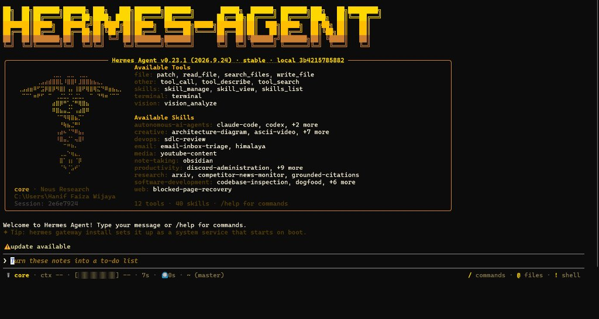

# Hermes Agent

Autonomous Discord Assistant & Workflow Execution Agent with persistent memory support.



## Ringkasan Proyek

Hermes Agent adalah asisten berbasis AI yang beroperasi melalui gateway Discord dengan integrasi memori jangka panjang (*persistent memory*) berbasis file Markdown (Obsidian Vault). Agent ini dirancang untuk menangani alur kerja otomatis, menjawab pertanyaan kontekstual secara real-time, dan memelihara status preferensi pengguna.

## Fitur Utama

- **Integrasi Gateway Discord**: Berjalan sebagai bot interaktif yang siap merespons percakapan di berbagai channel tanpa memerlukan mention berulang jika dikonfigurasi.
- **Persistent Memory via Markdown/Obsidian**: Menyimpan preferensi, riwayat, dan konteks berkelanjutan ke dalam format file Markdown.
- **Workflow Automation**: Mendukung eksekusi perintah terminal, pemantauan status, dan pipeline tugas.
- **Konfigurasi Aman**: Seluruh token bot, API key, dan path lokal dipisahkan ke dalam `.env` dan diabaikan oleh Git via `.gitignore`.

## Struktur Direktori

```text
hermes-agent/
├── images/                   # Aset gambar & dokumentasi
│   └── hermes_agent_thumb.jpg
├── memories_template/        # Template catatan memori persisten
│   ├── MEMORY.md
│   └── USER.md
├── .env.example              # Contoh variabel lingkungan
├── .gitignore                # Aturan pengecualian file sensitif
├── config.example.yaml       # Template konfigurasi sistem & gateway
├── requirements.txt          # Daftar pustaka Python
├── run_agent.py              # Skrip entry point agent
└── SYSTEM_PROMPT.md          # Petunjuk perilaku agent
```

## Panduan Instalasi & Penggunaan

### 1. Kloning Repositori
```bash
git clone https://github.com/haniffaizawijaya-maker/hermes-agent.git
cd hermes-agent
```

### 2. Pasang Dependensi
Pastikan Python 3.10+ telah terpasang, lalu jalankan:
```bash
pip install -r requirements.txt
```

### 3. Konfigurasi Lingkungan
Salin file template `.env.example` ke `.env`:
```bash
cp .env.example .env
```
Sesuaikan parameter berikut di file `.env`:
- `DISCORD_BOT_TOKEN`: Token bot Discord kamu dari Discord Developer Portal.
- `OBSIDIAN_VAULT_PATH`: Path direktori folder vault memori lokal.

### 4. Menjalankan Agent
```bash
python run_agent.py
```

## Pengembang

Dikembangkan oleh **Hanif Faiza Wijaya** ([@haniffaizawijaya-maker](https://github.com/haniffaizawijaya-maker)).
